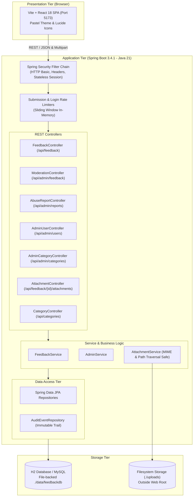
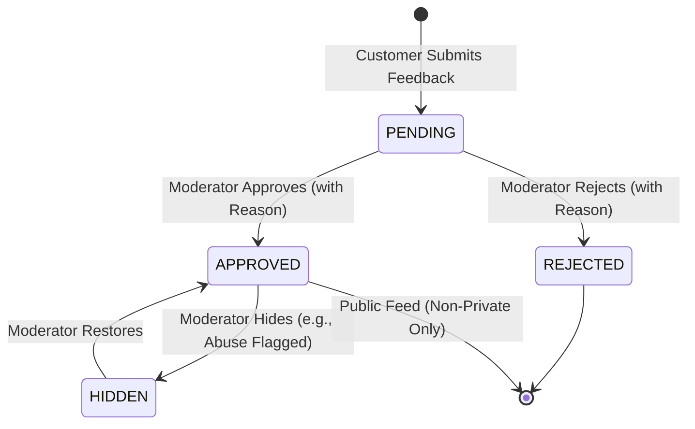

# Customer Feedback Portal (FeedbackHub) — System Architecture Document

## 1. System Context & Overview
FeedbackHub is a multi-role, security-hardened SaaS platform designed to collect, moderate, and publish verified customer feedback while upholding strict data isolation, role-based authorization, and comprehensive auditability.

---

## 2. Component Architecture & Layered Responsibilities
1. **Presentation Layer (React + Vite)**:
   - Dynamic role-based navigation with strict tab guarding.
   - Pastel SaaS color palette with high accessibility and contrast.
   - Multipart file attachment handling directly to the secure backend.
2. **Security & Perimeter Layer**:
   - `SecurityConfig`: Configures strict endpoint-level and method-level security (`@EnableMethodSecurity`).
   - `SubmissionRateLimiter`: Enforces max 3 submissions per 60-second sliding window per customer email.
   - `LoginRateLimiter`: Enforces max 5 failed attempts per 15-minute sliding window.
   - Centralized `GlobalExceptionHandler`: Masks server internals, traps file upload overflow, and includes correlation IDs.
3. **Business Logic Layer**:
   - `FeedbackService`: Manages feedback submission, ownership filtering, moderation status transitions (`PENDING` -> `APPROVED` / `REJECTED` / `HIDDEN`), and duplicate abuse report prevention.
   - `AdminService`: Orchestrates user account CRUD, activation status toggling, category lifecycles, and audit history inspection.
   - `AttachmentService`: Validates MIME types, extensions, enforces a 10MB limit, uses UUID storage keys, and prevents path traversal.
4. **Data Access Layer**:
   - Entity relationships with `@Version` optimistic locking on mutable models (`User`, `Feedback`).
   - JPA Specifications for dynamic search and filtering (`FeedbackSpecifications`).

---

## 3. Data Flow & Security Trust Boundaries

### A. Feedback Submission & Evidence Attachment Flow
1. Customer authenticates via HTTP Basic with local credentials.
2. `FeedbackController.submit` triggers `SubmissionRateLimiter.checkLimit`.
3. Category validity (`active = true`) is verified.
4. Feedback is persisted with `status = PENDING`.
5. Optional evidence is uploaded to `/api/feedback/{id}/attachments`:
   - Ownership check ensures `feedback.customerId == principal.id`.
   - MIME type and file extension are validated against strict whitelists.
   - File is stored under `./uploads/<UUID>.<ext>` outside the web root.
   - File metadata is recorded in the `attachments` table.
6. An immutable `FEEDBACK_SUBMITTED` record is logged in `audit_events`.

### B. Moderation & State Transition Flow

---

## 4. Architectural Decisions & Trade-Offs

### Decision 1: Stateless HTTP Basic Auth vs. JWT Tokens
* **Choice**: HTTP Basic over TLS/local with Stateless Session Creation (`SessionCreationPolicy.STATELESS`).
* **Rationale**: Eliminates complex token refresh ceremonies and CSRF token vulnerabilities on local/academic single-page applications while keeping backend requests fully self-contained, reproducible via curl/Postman, and strictly authenticated.
* **Trade-off**: Requires credentials to be transmitted with each authenticated request; mitigated in production by enforcing HTTPS and HSTS headers.

### Decision 2: UUID-Based File Storage Outside Web Root
* **Choice**: Store uploaded files on the filesystem outside public static directories using random UUID filenames (`./uploads/<UUID>.<ext>`) rather than database BLOBs.
* **Rationale**: Prevents database bloat, avoids executing untrusted uploaded scripts (e.g., PHP, JSP), and guarantees zero direct URL accessibility. Downloads are served exclusively through `AttachmentController` which streams the file with forced `Content-Disposition: attachment` headers.
* **Trade-off**: Requires local disk access and periodic storage cleanup routines.
