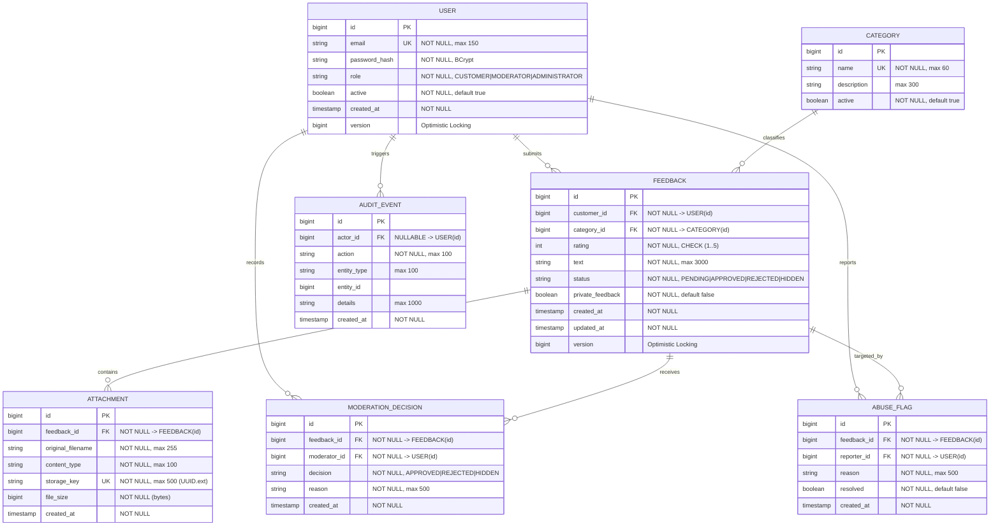

# Customer Feedback Portal (FeedbackHub) — Entity Relationship Diagram

## 1. Entity Relationship (Mermaid)

---

## 2. Integrity Constraints & Cardinalities
1. **Users & Feedback**: One-to-Many. When a user is removed, cascaded deletion cleans up associated feedback (or marks inactive via soft-delete in admin flows).
2. **Abuse Prevention**: `ABUSE_FLAG` has a unique constraint `UNIQUE(feedback_id, reporter_id)` to ensure a user cannot submit duplicate flags for the same feedback item.
3. **Attachments**: One-to-Many from Feedback to Attachments. Enforces strict maximum file size (10 MB), allowed MIME types, and UUID storage keys outside the web root.
4. **Optimistic Locking**: Handled on `User` and `Feedback` using JPA `@Version` to prevent concurrent overwrite anomalies during simultaneous updates.
